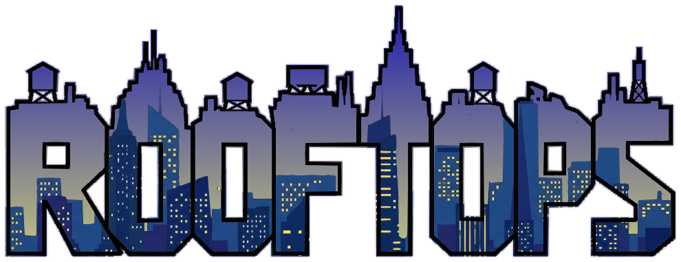
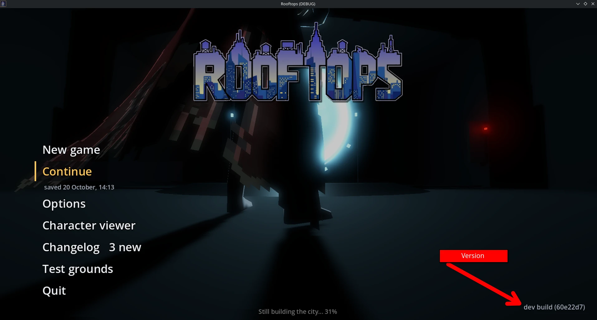

<p align="center"></p>

# Rooftops

Thanks for testing! Rooftops is a game Mo is making: a man running across Manhattan's rooftops who can
become Bis, a superhero who flies. It's not finished, so things will break. Telling Mo about it is the
most useful thing you can do.

## [Download the newest version](https://github.com/molobarjo/Rooftops-builds/releases/latest)

**https://github.com/molobarjo/Rooftops-builds/releases/latest**: under **Assets**, **Rooftops-windows.zip** for Windows, **Rooftops-linux.zip** for Linux. No account needed. The steps are just below.

## Getting the game (Windows)

1. Open **https://github.com/molobarjo/Rooftops-builds/releases/latest** (no account needed).
2. Under **Assets**, click **Rooftops-windows.zip** (about 140 MB).
3. Open your Downloads folder, right-click the zip, choose **Extract All...**, then **Extract**.
4. In the new folder, double-click **Rooftops.exe**.
   Keep `Rooftops.pck` next to it: that's the game itself.

**"Windows protected your PC"**: Windows says this about any program it doesn't know yet. Rooftops
isn't signed (a certificate costs money), so it gets this warning. Click **More info**, then
**Run anyway**. You only have to do it once per version.

It needs a reasonably recent graphics card (roughly from the last eight years). The first launch takes
a minute or two to build the city: the ROOFTOPS logo fills in as it goes.

## Getting a newer version

Mo's changes are built into a new version automatically. In the start menu, the version you have is in
the bottom right corner, next to **Updates**, which opens the download page. When a newer version is
out, the button turns gold and says **Update available**: download it the same way and delete the
old folder. Your saved game and settings are kept (they live elsewhere, see below). **Changelog** in
the menu lists what has changed. Anything new since the last version you played is marked in gold.

## The start menu

- **New game**: starts from the beginning.
- **Continue**: back where you saved. The game saves by itself every two minutes and when you quit, and
  you can save from the pause menu (Esc, **Save game**).
- **Options**: controls (change any key), sound and graphics. If the game is slow, pick a lower graphics
  preset there.
- **Changelog**: what's new.
- **Test grounds**: practice maps apart from the city, ready in seconds. The parkour test ground has a
  station for every move (gaps, heights, drops, climbing walls, vaults, bars, a tower to glide from);
  number keys 1-0 take you to each one, T lists them, and the keys in the top right corner switch on
  helpers (slow motion, the handholds, Bis...). You can also press T on the loading screen to go
  straight there without waiting for the city.

## Controls

Keys are by position, so on a French (AZERTY) keyboard "W A S D" are **Z Q S D**.

| | |
|---|---|
| Move | W A S D (or the arrow keys) |
| Look around | the mouse |
| Jump / jump off a wall / open the jacket in the air (glide) | Space |
| Sprint | Shift |
| Slide at a run, climb down, landing roll | Ctrl |
| Use (change into Bis in a phone booth, by its door; buy a jacket; launch the X-Jet; a lift) | E |
| As himself: shout a warning at a construction accident | E (with nothing to use nearby) |
| As Bis: take off / land | double-tap Space, or V |
| As Bis: go faster in flight | Shift |
| As Bis: use a power / next power | W on a French keyboard (Z on English) / Tab |
| Slow time (Bis) | R |
| Fight: strike, counter, takedown | F, C, X (or left, right, middle click) |
| Map | M |
| Pause menu (all the controls, settings, save) | Esc |
| Stuck? Respawn | Esc, then the **DEBUG** tab on the right: Teleport > Respawn |

The full list is in **Options > Controls**.

## Found a bug? Tell Mo

Send Mo:

1. **The version**: bottom right of the start menu, like `v2026.10.16.1432 (4ba034f)`.

   

2. **What happened**, and what you were doing just before. A screenshot or a phone video helps a lot.
3. **The log file**, if the game crashed or behaved strangely. Press Windows+R, paste this and press
   Enter:

   ```
   %APPDATA%\Godot\app_userdata\Rooftops\logs
   ```

   Send the newest `godot*.log` file in that folder (or all of them).

Your save and settings are in the folder above that one (`%APPDATA%\Godot\app_userdata\Rooftops`).
Delete `save.cfg` there to start over completely.

## Changelog

What has changed, newest first (the game's own **Changelog** shows the same).

**20 October 2026**

- A cleaner keyboard layout (Mo picked it from a review of every action). E is the one "use" key: change in a phone booth, the X-Jet's button, a jacket shop, a lift; with nothing to use near, as himself, it shouts the warning (was U, and Y for the shout). R is Bis's slowed time (was E). The map is on M on AZERTY and QWERTY alike (QWERTY players had ";"). V alone lets go of the plane (L is gone); middle click is a takedown too. Respawn and the time of day lose their keys (Esc > DEBUG has them), music on/off too (the Audio page's slider). use_booth is now interact and debug_fly is fly; saved controls carry over: anything you rebound stays as you set it, only what was still on its old default moves. The HUD's "TAKEDOWN READY" shows your takedown key, not always X.
- Bis's own fighting style (Mo): in a fight he hovers a hand's breadth off the floor, never planted; he flies from man to man (a short, straight flight, leaning into it, up to a ledge or down off one), and every blow is one quick jab, no wind-up, the other hand each time, never a kick: an ordinary thug needs no more, and Bis's hit floors a man for a day anyway. A counter is the same jab, no parry; the special is that jab sending the man flying; finishing a man on the ground he hovers down over him and jabs down. The man's whole moveset (kicks, wind-ups, the spinning special) is kept for bosses: a man flagged boss_fight gets it, and bis_full_moveset switches it on for every man (PlayerCombat, "Bis" group).
- Takedowns error-checked and fixed. A new test (tools/takedown_test.tscn) runs the finisher and the special against every kind of enemy, as himself and as Bis, against a wall, by a wall, on stairs, at a roof edge, on a slope, beside another man, pressed twice, mid-air, in slowed time, with the man despawned, finished by someone else, cuffed or getting up mid-move, and where X must do nothing; frame by frame it checks who it hit, both bodies against the floor and walls, teleports, the two bodies through each other, the man staying down and the combo meter. What it found and what changed: a man despawned mid-finisher crashed the game (fixed); the finisher knelt on the man's legs and punched his shins, now it picks a spot by his chest clear of his limbs, goes round him to it and slides in on one knee; finishing a man replayed his fall from standing and spun him round his feet (now he is finished where he lies); a standing man beside the one on the ground could be put out cold by the ground punch (only its own target now); X could finish a man on a floor 3 m up or through a wall (now his own level and in plain sight), or one still falling (now once he has landed); a takedown now stops if the man gets up, is cuffed (Enemies.claim(), for the police) or is finished by someone else first; knocked down by a wall, a man fell into it, now he falls the nearest way his body has room (never off a roof edge either); on slopes and stairs a man lying down sank into the ground, now he lies on it; a lying man's arm in the floor is lifted out; the special leaps up stairs into a flying kick and kicks straight in by a wall; X pressed in the air waits for the landing. On uneven ground he crouches over the man instead of kneeling, and his planted feet now stand on a slope or a stair instead of level with his hips (CombatPoseModifier.ground_probe). With Bis's own style (below) and the finisher's way in planned once as it starts, 134 of the 138 cases pass; still open: on stairs and slopes the man's foot can sink into the step as he kneels or rises (his hips don't follow the ground yet, only his feet), and Bis's special up a flight of stairs can leave him in the man it knocked back.
- The builds go public, the code stays private: each build is now a release of the public repository molobarjo/Rooftops-builds, so the family downloads it without a GitHub account (https://github.com/molobarjo/Rooftops-builds/releases/latest). Its front page is rewritten with every build: what the game is, the download link, how to install and play, how to report a bug, and this log. The start menu asks it for the newest build and, when there is one, its Updates button turns gold: "Update available - Download".
- His leather jacket repainted after Mo's two photos (a distressed brown A-2, front and back): mottled, creased leather worn pale at the shoulders and elbows, zipped to a collar, a yoke across chest and shoulders, two patch pockets with slits, knit cuffs and waistband, two seams down the back to a buckled strap at the small of the back, elbow seams (tools/paint/paint_jacket.py, seamless like Bis's suit); and it stands 5 mm off his skin (Mo), pushed out by the shader where the jacket is, fading out before his wrists and neck. The torn jacket is made from it. Its collar is geometry (Mo): a short stand round his neck, turned down wide over his shoulders and chest into two points beside the zip, leather outside and its blue lining inside; the side seams painted; no vertex on a seam with his skin is raised, so no crack at the neck or wrists.
- Mo's new Mixamo climbing clips in: the braced hang (at rest with the feet on a hold), the braced shimmy (along a hold), the braced hops left and right (the leaps sideways: the ledge hop), the free-hang and braced drops (letting go, by whether the feet were on the wall), a second hanging idle. The drainpipe climb is new: Mo's mix, the rope climb's arms over the wall climb's legs (tools/mocap/mix_moves.py, pipe_climb), half its cycle a hand's reach, played back going down.

**19 October 2026**

- The wall hang, the pipe climb, the wall climbing and the fighting captured (Mo). Climbing keeps its geometry (hands on the real holds, the body where WallClimb and LedgePoses put it) and takes the climber's shape from Mixamo's clips laid under each key (MocapClip.base_over): the hanging idle's sway at rest, the climbs up and down a wall for the steps, the braced hop under the leap sideways (a ledge hop), the free-hang climb under the dyno, the general climb up a drainpipe (no pack has a pipe or rope climb), the climb to the top under the pull-up. The fighting keys (CombatPoses) are moments of the Humane pack's punches, kick, jump kick, block and hit and Mixamo's elbow, uppercut, flying knee, superman punch and martelo, each locked to the figure's facing at the clip's start (a punch turns the hips; the fist still goes where it went) and solved into the combat springs as before, the IK landing them on the man. The climb, ledge and fight tests pass as they did (the ledge's parapet hang fails on main the same way, a toe in the wall for 8 frames).
- The Men in Black put their sunglasses on only for the neuralyzer: as it comes out, all of them, and off again as it goes away.
- Bis to Reeve's outline (Mo: the three Superman photos as an outline, Reeve's the one): measured against the photo as fractions of height, his legs, chest and thighs already matched; what didn't: the belt (now at his natural waist, 0.39 of his height from the crown, not down at the hips), the shoulders (4.5 cm out instead of 3), the arms (the shared skeleton's upper arm is short: Bis's is 1.2 times it and his forearm 0.97, the hands moving with them), the knees (legs a little fuller) and the flanks under the arms (15 to 25 percent wider than Reeve's for his height: the lats' flare 1.25 to 1.1). The stance's fists sit on the belt at the waist, elbows out as Reeve's. Then Reeve's outline traced out of the photo and laid over him (tools/protagonist/outline_check.py, reference/characters/reeve_outline.png): shoulder line and legs matched; his elbows were 8 cm a side further out and his arms thicker, so the stance's elbows go out to 45 degrees and the arms are fuller (upper arm 0.55 of its thickness, forearm 0.3). Then Mo's cut-out of Reeve without the cape, the cleanest outline: elbows still 6 cm a side short, the shoulders 3.5, so his upper arm is 1.32 times the shared skeleton's (Reeve's 0.165 of his height), the forearm 1.0, the shoulder joints 6 cm out and the caps 4 cm wider. Then the photo itself laid over him at half opacity (photo_over_render.png, Mo's ask): his belt and fists 3 cm higher still (the waist at 0.37 of his height), his shoulder line 2 cm higher (the trapezius and caps), the caps 5 cm wider. And a fix the overlay found: lining up his stance with Reeve's, his shoulder joints sat 7 cm in and 11 cm back in the stance, because the collarbone had been pointed at the moved joint and the bearing's collarbone offsets turn in its frame; the collarbone keeps the shared skeleton's frame now and only the joint it carries moves. And the bug under it all: Bis's own skeleton never reached an animated pose. Every clip keys every bone's position from the rests at start-up (the man's), and the built clips (the stance, landings, flight) were solved against the man's bone lengths, so a change of rests at the booth showed only at rest. The animator now re-keys those positions and rebuilds its solved clips when the rests change (Animator.rests_changed()): his broader, lower shoulders and longer arms are in every pose, and his stance's elbows land on Reeve's. His cape now drapes over the shoulders (Mo): it lies out over the shoulders' caps, 27 cm from his spine instead of 15, and hangs 50 cm wide from his shoulder blades instead of 34. And, standing or moving easily, it catches on his elbows and hangs from them (Mo: "magnetise" it to the elbows, as Reeve's), letting go as he speeds up.
- Bis stands in line, like the NPCs (Mo: in the T-pose his arms came out too high; side on, head, shoulders, hands and knees should be one line): on his own skeleton the shoulder joints are 7 cm lower, where his flesh is bound (the shared rest held them 8 cm above the pack's own, so in the game his arms hung that much higher than modelled), and forward onto the line of his hip joints; each ankle under its knee. His flanks under the arms thinned a bit (Mo). The suit follows the new joints. The Bis showcase now also holds him in the T-pose and the A-pose. His hero stance moves from the A-pose (Mo): fists on the belt over the hip bones, elbows out about 40 degrees and a little back, no further, so the shoulder caps (a few vertices sharing the arm's and the trunk's weights) stay round instead of shearing flat.
- Bis's suit reskinned after Mo's reference sheet, minus the chest emblem: navy, dark grey piping down the sides of the chest and meeting at the small of the back, down the arms and thighs and round the knees, grey shoulder caps, a thin gold belt and buckle, grey pointed wrist bands, red boots up the calf with a point at the front, a high plain collar. Painted from code on his body rather than in the sheet (tools/paint/paint_bis.py), so the lines run unbroken over the texture's seams, and so is the shading, baked into the texture in flat steps: a light from above, pecs, abs, shoulder blades, quads and calves as shapes on his body (Mo's painted shading had seams between the pieces). The worn Bis of the opening is the same suit used up. Mo's painting is kept as a hidden layer in the template.
- The Men in Black's suits flat, as in the animated series (no creases at the joints), with white cuffs; agent 03 made J-like (brown skin, a moustache) and agent 06, the older gentleman, K-like (steel-grey hair slicked back). Mo's agent 04 left as he painted it.
- The agents' jackets drawn on (lapels, buttons, pocket flaps), J given a flat-top (his head's crown raised) and a fuller moustache.
- The agents' suits closer to Mo's reference sheet: flat colour, notched lapels, a deeper shirt V, the white collar round the neck, the front cut away below the button to a hem, a seam down the back. Agent 04 (Mo's painting) given the same suit at his word, his face kept; agent 05's rolled-up forearm sleeved.
- The parkour moves are captured ones (Mo: the wall run and the wall jumps, with all the parkour necessities, playing in the right spot, in place of the generated ones). ParkourMoves plays slices of the captured clips through the PoseOverride: the speed vault and the kong off the parkour showcase, their hands going down, middle and hands coming off warped in time to where the obstacle's face, middle and far side are along his run, the hands put on its top by a reach, the hips carried over it; the tic-tacs (tic_tac_right / _left, by which side the wall is, the kicking foot on it); the stuck landing (jump_land_feet). New: a wall run. Jumped at a tall wall face on, he strides up it (Mixamo's wall run), the strides holding his rise so a one-storey wall's ledge comes within reach, then the ledge is caught as ever. The slide keeps its hand-written pose (the showcase's capture of it is a belly dive). tools/parkour_test.gd runs them all, the wall run added, and tools/parkour_ground_drive.gd runs them on the test ground's own stations (Mo: test them all in the test map): all pass. Found there: a railing a few centimetres through was never vaulted (the top probe missed it), and a wall's height for the wall run is read from the ground he jumped off, not from where he is in the air.
- Jolt no longer slow: the city's collision used to go onto bodies already in the scene, a shape at a time, and Jolt rebuilds a body's whole shape every time one is added. Now each body is filled before it goes in (the blocks round the start: 22 s -> 4.5 s under Jolt in the cloud; the elevated lines: 27 s -> 0.6 s), and identical hulls (water towers, antennas, El girders) are made once and shared. Also gone: the "Basis must be normalized" errors from the fighting poses (the new man's rig carries a little scale; the hand and foot reaching now turn only the rotation).
- The men in the crowd, banks, police, fire crews, gangs and MIB no longer shrug when they move (Mo: shoulders up in the walk): the pack's animations lifted their shoulders 2-3 cm above where their bodies were made; a correction on top of the animation lowers each man's collarbones by his own difference, so his trapezius runs on into his shoulder. Their bodies are unchanged.
- Every NPC's face is one piece to paint (its own texture, the face in the middle), not the pack's two halves; and the Men in Black wear Wayfarer sunglasses, each pair fitted to its agent's head.
- The Men in Black wear black suits, white shirts and black ties (Mo): agents 01, 02, 03, 05 and 06 painted the way Mo painted 04; 04 keeps Mo's painting, its trousers taken to black like the rest.
- The captured moves reviewed on the PSX man (Mo: review the animations, replace what was generated, check for clipping, test with the new model, on the parkour map). What was wrong and is fixed: a captured key (free) was solved with no hinge at all, so knees and elbows bent sideways or backward by up to 150 degrees; now the hinge still turns to face the way the lower bone points, with nothing clamped (the upper bone turns as far as it must, the fold goes past the human most, the knee's turn stops at a quarter so a knee locked past straight folds back a little instead of the thigh turning round), and the turn fades in with the bend so a limb passing through straight no longer snaps its upper bone half round (177 degrees in one frame, before). The pack conversions (fbx_to_poses.py) gave the pelvis under half the trunk's lean, so a roll or a flip bent at the waist instead of turning over: the hips' own lean now goes to the pelvis in full; all 171 pack moves converted again. The video captures put his feet up to 60 cm through the floor (the tracker's figure has shorter legs): the pelvis's height is now worked out from the game's own leg lengths, and a captured key whose feet still come out under the floor is lifted onto it in the solve. A hand laid flat on a floor with the forearm straight down built an empty basis (an error flood in the audits). The audit's mocap part (--only=mocap, the probe's joints_free) and tools/mocap/audit_summary.py grade the 270 moves: 98 with nothing to note, 83 with only a limb against the body (tucks, mostly: the thigh pressed to the chest), 63 with a knee or elbow still reading backward somewhere (video noise, real-footage stretches), 73 with a snap left, 15 with hands under the floor (moves draped over a block: a vault, a slide, a hang, which only make sense with their obstacle). First two captured moves in the game, over the hand-written clips (CharacterAnimator.MOCAP_CLIPS): the long fall is the Humane pack's skydiver spread, the swimming stroke its breaststroke. The parkour test ground's check passes with them in.
- Clipping read off the real mesh (Mo: no big clipping, minimal is acceptable, check with the wire mesh). tools/mesh_clip_dump.gd poses the PSX man through every captured move and writes his skinned vertices; tools/mocap/mesh_clip.py reads them part against part by winding number, beyond the rest pose's seams, folds at a joint apart; mocap_preview --wire shows a pose as lines. It found the forearms through the chest and belly in most captured moves (12 cm: a figure built otherwise than he is), so a captured key now goes through SelfContact: the limbs swung out of his trunk, fitted to the mesh he wears, the same shapes the pose audit's probe uses. With it the knee's swivel is measured from the pelvis's own hinge (a thigh pointing straight up flipped it before) and the hinge blends in by direction, not angle. By the mesh, the 270 captured moves went from 6 clean, 28 minimal, 66 noticeable and 170 big (over 6 cm) to 41, 62, 77 and 90; the two in the game (the long fall, the stroke) are clean. What is left big is mostly an arm the figure swept right through its own body (a roll, a vault), kept in a little rather than leaping out. G on the parkour test ground drops a gang round him to fight on the course.
- The NPCs stand straight in their rest pose, like Mo's jointed figure: knee under hip and ankle under knee, shoulders, elbows and hands on the same line, arms straight out and a little lowered, each measured on its own skeleton (their animations are unchanged by this). Their arms are a little shorter, the men's belly lines up with their hips, and everyone's front is flat from chest (a woman's from under her bust) to groin.
- The NPCs' shoulders and hips where theirs are (Mo: arms coming out too high, a lump at the shoulder, the side of the shirt stretched straight): their skeletons now take their own shoulder and hip joints' width and height. The women's hips tip forward (waistband level), their clips stand upright (Mixamo's straighter spine made them lean back), and a fleeing woman runs at her run's own pace instead of whirling her legs to the men's sprint speed.
- The women walk, stand and run as women: Mo's Mixamo clips (Female Walk, idle, running and 20 more, in reference/anims/mixamo/female/) retargeted onto the game's skeleton, played by every woman in the crowd, the banks, the police, the fire crews, the building sites and the gangs, and in the Character viewer; the crowd's far-off cutouts of the women are drawn from them too.
- The NPCs each stand on a skeleton of their own proportions (their own leg, trunk and arm lengths, shoulder and hip widths; before, everyone was stretched to the man's), the clips' hip movement scaled to their own hip height so their feet stay planted; their seat tucked under them (15 degrees) so the line from the back down the legs runs straight.

<details>
<summary>Older changes</summary>

**18 October 2026**

- Every PSX NPC (crowd, bank, MIB, police, firefighters, enemies) now stands on the skeleton as Bis does: shoulders level with the spine instead of 6-7 cm forward, the pelvis tipped under them instead of rolled back, upright over the ankles. Their textures (and anything painted) are kept as they are.
- Everyone in the streets is a PSX pack character now, with a texture to paint: the crowd (172), the banks' staff (35) and the MIB agents (6), each in place of one of the old scanned figures, of the same sex and build, and named for who they are (crowd_042_heavy_man, bank_teller_lois_lane...). Repeats of the same pack character have their clothes recoloured. In the Character viewer, Make paint template writes a Krita template for any of them. The far-off crowd cutouts were redrawn from them.
- A smoother start menu: the city still building behind the portal room's opening shot now gives up almost the whole frame. Each block slots in a couple of pieces and a hundred-odd collision shapes at a time (about 5 ms a frame), and the heavy one-offs - the firehouses, station houses and construction sites - wait until play starts, then go up one a frame. The log now says how long each loading stage took and how much of each frame the building took while the menu was up.
- The Character viewer is a gallery of everyone in the game (as in Detroit: Become Human): portraits down the left by group (the man and Bis, pilots, police, firefighters, enemies, MIB agents, bank staff, the crowd: 258), the one picked on the turntable with his editable textures shown beside him, reloaded as they are saved. The 40 with a texture of their own (pilots, police, firefighters, enemies) got paint templates like the man's, and their builds now keep a painted texture. The viewer no longer flattens an old template over a painting on opening (R does it on purpose).
- Back from the Character viewer or a test ground without rebuilding Manhattan: the city is set aside while you're in there (kept whole, frozen, out of sight) and put back as it was - the start menu again if you went from there, or the game paused where he was if you went from the pause menu.
- The enemies, the police and the firefighters are people from Mo's PSX character packs, the same family as him (tools/figures/psx_cast.py): a street gang in tees, shorts and jackets, the syndicate in dark shirts and suits under a boss in a red tie, heavies in black tactical kit and balaclavas, NYPD officers in navy, FDNY crews in turnout gear (still wearing the game's helmets and air cylinders). Every fight move, gun hold and animation plays on them as on him.
- The gunmen's guns are the LP Weapons Pack's (revolver, pistol, UMP45, AK, SCAR, machine gun, SVD, scoped rifle) in place of the sheet guns, held in Mo's own Blender holds (the shotgun and the heavy's HMG stay the sheet ones). Animations from the packs that were never used, where they fit: gunmen carry a magazine and reload when it's empty (a window to close in), and lean to aim when he is well above or below them; people the Men in Black flash scratch their heads, then shuffle off dazed for a few seconds before walking on.
- The island's blocks are now worked out on the CPU's other cores (worker threads), every core but one while the start menu is up, a few in play; the main thread only puts the finished pieces in place (in the cloud, 78 s of building work moved off it, 6 s left on it). Less hitching while the rest of the city builds round him, and a faster full build. The log's "Manhattan built" line now says how the time split.
- Loading: the start menu comes up as soon as the blocks round the start are solid (about a third of the old wait), and the rest of the island builds behind it - faster while the menu is up - then on round him as he plays, nearest first. "Still building the city... N%" under the menu says how far it has got. Continue to a spot not built yet builds round it first, under the black; the jacket shops go up as their streets are built.

**17 October 2026**

- Street props lit the right way up: every cart, umbrella, newsstand, bike, dog, the carriage and the pigeons were built inside out (their faces wound the wrong way for Godot), so they looked lit from the ground; the Central Park drive's paving too.
- From Mo's logs: no more errors from the cape and the city's cries as the game closes, and finding the phone booths near him (for the visitors and the change) no longer reads every booth back from the rendering server - a wait on it every time, hundreds of them in one session.
- The parkour test ground: a debug map apart from the city, from the start menu's new Test grounds (or T on the loading screen, or -- --test-ground=parkour), loaded in seconds without building Manhattan. Ten stations along a road, each with a sign and floor markings giving its numbers (worked out from his own settings, so they stay true when tuned): gaps 1 to 6 m, heights 0.3 to 4 m coloured by the move they take, drops from 2 to 20 m over landing pads, a kit of every roof the city uses, two walk-ups with fire escapes and a plank across a 7 m alley, the city's own facades to climb (brick walk-up, a corner, a drainpipe, a scaffold, a sidewalk shed, a sign, and a glass curtain wall with no holds), vaults and a slide gap, bars, beams and precision posts, a chimney and a tic-tac wall for wall kicks with a 12-storey grip wall, and a 100 m tower to glide from over lines every 10 m. Blue LIFT pads put him on top of things; keys 1-0 jump to a station, T lists them, H shows every collision shape, J the handholds, K slow motion, I infinite grip, B switches himself / Bis, P hurt / healed, O a new jacket, F3 the performance overlay; the pause menu's DEBUG tab has them all, and Quit to title there goes to the ground's own title (back in, the full game, or quit).

**18 October 2026**

- Outfits as paintings: the man's leather jacket (whole and torn) and Bis's costume (and the opening's worn-out Bis) are now textures on the new man's own model, each with a template to paint (assets/character/protagonist/outfits/), started as recolours of his painted shirt. Bis is the new man in his costume with his cape; the Character viewer shows all five.
- The new man's build reshaped (Mo's sketches): he stands straight (his hips turned under him onto the skeleton's, his trunk, neck and legs on its straight lines, where he used to stand hips back and back arched), his belly and flanks no longer bulge and his seat is flatter. Bis, built apart from the same mesh, is broad and square-shouldered with big arms (his own skeleton's shoulders 10 cm further out each side, taken on as he changes; deltoids rounded, upper arms 80% and forearms 35% thicker) with a flatter belly; the man keeps his own frame and his slight slouch. Bis's hero stance stands tall: legs straight (his hips raised to straight-leg height, his feet under them), no bend at the knee. His suit is skin tight: his trunk and legs smoothed of the shirt's and trousers' folds and his legs drawn in (his arms, shoulders and upper chest as they were). No faces poke through anywhere on either model now (checked face against face): the pack's right hand had its finger bones misplaced, which folded its fingers through each other; it now takes the left hand's joints and weights, mirrored. The collision capsule is kept at most 0.24 m wide.
- Bis's shoulders to Mo's outline: big trapezius muscles rising from the shoulders into the sides of his neck (behind the collarbone, so the front of his shoulders stays clean), and each shoulder a ball: a sphere where Mo circled it (tools/protagonist/bis_shoulder_balls.json, shown on him by pose_check --balls), his shoulder's cap split into finer triangles and pulled onto it. Both models are now exactly symmetric, left and right (joints, skin weights and shape).
- Back to the PSX man for Bis (the buff body tried today is taken out again), and both models' shapes are now Blender files Mo can touch up himself (assets/character/protagonist/sculpt/, X-mirror on): once saved, the build takes his shape from them. PAINTING.md says how.
- The sculpt files' skeleton stands as the model does (it was in its T-pose rest while he stood arms down, Mo): posing it in Blender now bends him as the game does.
- Bis's shoulders back, level with his spine (Mo: like a gorilla, his shoulders too far forward): the man's shoulder joints sit 7 cm in front of his spine; Bis's collarbones turn back so his shoulders and arms hang in line with his back. The sculpt files' bones now join up into one skeleton (each running to the next).
- Bis stands upright (Mo: he leaned a bit forward; his head now over his ankles, tilted back about 2 degrees about them) and has big lats (Mo's green zone: his flanks fill out to a line from the armpit down to the belt, a V).
- Bis matched to Mo's front outline (the green zone): shoulders and arms brought in (his arms 3 cm out from the man's skeleton instead of 10, the shoulder caps no longer bulging past the arm line), arms slimmer (the fuller arms of the morning undone and a little more), his flanks kept where they were.
- Bis's neck straighter (turned back 10 degrees, his head back about 1.5 cm and kept level; Mo picked it from 10, 20 and 30) and fuller arms, shoulder to wrist, hanging a little further out (7 degrees lower than the man's instead of 10; Mo's outline).
- Bis's arms hang nearer his sides (10 degrees lower) and his legs are thicker (thighs and calves a fifth fuller, slimming to the ankle), and the top of his lats is trimmed 2 cm (his trunk checked against Mo's outline: right from the waist up, a touch too full just under the armpit).

**17 October 2026**

- Painting the man yourself: his head now has a texture of its own, one upright piece (the face in the middle, ears below) instead of two sideways halves in the body's; each texture has a layered template to paint in Krita (assets/character/protagonist/paint/, the UV wire and the pieces' names on their own layers), and the new Character viewer (title screen, or the pause menu's DEBUG tab) shows him on a turntable in the game's look, reloading the texture the moment it is saved. See PAINTING.md.
- A new protagonist: the PSX character pack's Male 36 (white shirt, tie, dark trousers), his Mixamo rig matched bone for bone to the game's skeleton and his mesh bound to it in his own pose with his own skin weights (tools/protagonist/build_psx_man.py), so every clip, pose and fight move plays on him. The jacket isn't drawn on him until it is rebuilt to fit him.
- The Els' stations rebuilt after the real Victorian ones: one at each line's real stops (66 in all), each with a side platform each way under a peaked iron canopy on fluted cast-iron posts with globe lamps, a little clapboard station house at the cross street's end (arched windows, a steep slate gable with fretwork, a finial, the line's name board) that you walk through from the stair to the platform, and a covered iron stair down to the sidewalk. The big stops (14th, 23rd, 34th, 42nd, 59th, 72nd, 86th, 125th) have two-storey houses with a cupola and a footbridge over the tracks. The roofs and the canopy are climbable, the posts are poles, and the windows and lamps light up at night. Every stair comes down on clear sidewalk: at least 3.3 m left to walk past it, never in front of a crosswalk, no scaffolding on the buildings beside it (2 real stops with no clear spot, and 2 on the Sixth Ave ramp, are left out).
- The Els' pillars follow the street grid: no bent stands in an intersection or on a crosswalk any more. Each block gets its own evenly spaced bents (15 m apart at most), and the deck jumps each cross street in one longer span on deep plate girders, like the real Els. The lines end over their last bent instead of out over an intersection, and the El avenues' kerb lane is moved out so a bus clears the legs (Second Avenue). Next: the stations, rebuilt after the real Victorian ones.
- sync.sh leaves new files too big for GitHub (over 50 MB, an asset pack's zip) on the PC, listed in .git/info/exclude, instead of the whole upload being refused.
- Collision that works under Jolt too (the developer switch): Jolt refused tens of thousands of convex shapes (the ground's slabs, the skyline props, LaGuardia's, the elevated lines' and the shore's), spamming the Debugger's Errors tab and leaving holes. Each shape is now built round its own centre instead of in kilometre-out world coordinates, with doubled points and near-straight corners dropped. Under Jolt the headless run now builds every one of them.
- Fix: the game froze (the editor's debugger stopping on a script error) when a construction site's scaffold went over after its crew had been put away, flown away from: the event no longer reaches for a crew that isn't there.
- Men in Black, step 3: alien incidents and the neuralyzer in play. A big alien bug crawls up out of the nearest subway stair and scuttles about on the sidewalk, people staring and filming; or a flying saucer hangs low over the Hudson off the West Side, lights chasing round, and people line the waterfront. The agents' LTD comes in by road (stopping at red lights, the traffic stopping behind it), two agents get out: one shoots the bug (it rears and hisses, then bursts into green goo); the saucer is gone by the time they're there. The other says "Nothing to see here. Move along.", then "Look here." (or the droids line), raises the neuralyzer like Agent K and flashes: everyone in front of it stands blank for a few seconds, then walks on. Him too as himself, if he's close and looking: white, then a blurred, swaying view, muffled sound, no moving. Bis it doesn't touch ("...That doesn't work on him."). Then the weather balloon or the figment line, and they drive off. All the agents' lines play. Only from the pause menu's DEBUG tab for now (Mo's choice): "Alien bug" and "UFO over the Hudson". New tools/alien_incidents_check.
- The sidewalk newsstands redone after the city's own glass-and-steel kiosks: smaller, brushed steel below the counter, glass with the magazines racked behind it above, a lit ad on each end, a slim NEWSSTAND sign band and a thin silver roof, today's Bugle and Planet on the counter.
- Mo's new logo everywhere the game shows its name: ROOFTOPS in chunky outlined letters topped by a Manhattan skyline (water towers, the Empire State, the Chrysler), a dusk city inside. Cut out of his 1024 px copy by a re-runnable script (tools/logo/make_logo.py; a bigger or transparent original dropped in assets/ui/source/ replaces it), its colours pushed a little richer, with a thin pale rim so the black outline reads on black. It is the loading screen's progress bar, the start menu's title, the window/taskbar icon and the Windows .exe's (its R and water tower), and heads README.md and PLAYING.md.

**16 October 2026**

- Birds: pigeons now also sit in rows along the roof ledges (they drop off the edge when spooked), flock properly in the air (each keeping its place, banking with the others), are spooked by a hard landing nearby, and a sonic boom throws every flock in reach outward. Gulls over the rivers and the piers (soaring, standing, floating, crying). Flight 1549's bird strike is now seen: the skein of Canada geese, four of them into the plane, the bang, flame and smoke from both engines, the rest scattering. Wingbeats follow the game's clock, so slowed time slows them. New sounds: gull cries, the geese honking, the strike (generate_birds.py).
- Shorter thumbs for everyone: every figure built on the mannequin (the crowd, bank staff, firefighters, fire victims, ironworkers, enemies, police, pilots, the Men in Black) now has a thumb a third shorter, as Mo asked, so it no longer pokes out of a closed fist. The agents hold the neuralyzer a centimetre lower, so all three of its dials show above the fist.
- NYPD station houses, step 1 of the police plan (stations; then patrols, then dispatch): the 22 Manhattan precincts at their real addresses plus RoboCop's Metro West, walk-in (lobby, desk, holding cells, muster room, built only near him), radio cars angled out front, officers coming and going, RoboCop on duty with his Taurus. Key 1 and the DEBUG tab's list go to them; the map has a Police stations layer. Agreed with Mo for later: police judge who started a fight he's in, are wary allies to Bis, and every police car will come from a precinct (the random ones in traffic go).

**17 October 2026**

- Animation audit, wall clips fixed at their source: on the wall the knee on a foothold turns out and the hips sit back (it went into the brick); the kong's and speed vault's hips ride higher so the feet clear the box; over a ledge the hips push back for the raised knee and the feet come up outside the lip, and out past a stepped cornice; hanging from an AC unit he hangs off its front, not the wall behind it (his head was in it); running up against a parapet, a knee still in it after the foot is lifted swings the thigh back.
- The Daily Bugle re-audited for clipping and thin walls (a new headless audit, tools/tower_audit.tscn, now clean for the Bugle and the Planet). Fixed: the stairwells had no collision in their walls; the walls between the Bugle's lobby, corridor and press hall had no thickness (now 30 cm, the doorways lined); the corner quoins filled the corners 80 cm into the rooms (now L-shapes round them); inside the stairwell the doorways were walled over from a metre up; the stairs were floating slabs from below (now a soffit and stringers); the glass offices' walls are 16 cm with their door lined; the Planet's lobby dome had no collision and its lift a paper-thin front. The stair rails (Mo spotted one cutting through a landing) now rise with their flights, on posts.
- The walk-in towers' rooms no longer look flat: their one indoor light now shades them (walls, steps and furniture each a different shade by which way they face) and casts shadows while you are inside - desks, chairs, people and rails onto the floor. Only the rooms' own things cast, so the city outside costs the shadows nothing.
- Animation audit: the pose audit now also checks his limbs, trunk and head against the world (walls, ledges, holds, vault boxes): how deep past the face, with a picture of each move's worst moment (Claude outputs/pose_audit/walls/). A knee or hand through the ground counts as the floor's. Hands on climbing holds are left out (the building's collision is one box that fills its window openings, so a hand over a sill reads as inside the wall when it is in the opening).

**16 October 2026**

- Animation audit, stage 2 (knees and elbows, from Mo's drawings): a knee in the way of a wall comes up and forward instead of folding backward (running at a parapet, stepping up, the stance); his wall contact stands down while he climbs, hangs, mantles or vaults (it fought the climbing poses: hands flipping half round, knees bent backward), eases in and out instead of snapping, keeps the wrist within a wrist's range and turns a palm to a new face gradually. The kong is a dive (the whole body tipped forward from the hips, head up, knees tucked); on a wall one foot stays on the hold and the other leg hangs long; hanging, one leg long and one bent back; over a ledge the knees come up forward, not swung out wide.
- Animation audit, stage 1 (report only, nothing in the game changes): a table of how far each human joint goes (joint_limits.gd; Bis 3 degrees looser, 5 degrees of comic-book allowance), checked against the motion capture the game plays, and a pose audit (tools/pose_audit.sh) that plays everything the player's body does, as himself and as Bis, and reports joints past their limits, limbs through the body, feet through the floor and joints snapping, worst first, with pictures.
- The DEBUG tab sorted into Spawn, Teleport, Events and Tools, with developer switches under them to A/B on a real PC (Jolt or GodotPhysics, Forward+ / Mobile / OpenGL, render thread, physics ticks, physics interpolation, occlusion culling, LOD bias; the engine ones on the next launch). The debug keys are gone (a saved controls file loses them once); N still runs the clock. The benchmark report lists every switch.
- The Bugle's and the Planet's models textured (after Mo: "more variety, and UV maps for depth"): ashlar, white brick, granite, riveted steel, brushed gold, gravel roofs, each with a normal map so joints, rivets and grain catch the light, mapped at real scale; each stone and pier a shade off the next, grime near the street. Then (Mo: "not just one texture") the Bugle's arches built stone by stone - voussoirs and a proud keystone, pilasters of dressed blocks with real joints, a fanlight over the doors, arched windows either side - and the Planet's entrance posts in granite blocks.
- The Daily Planet, walk-in and modelled in Blender (tools/blender/build_daily_planet.py, closed solids, 0 overlaps), after Superman (1978)'s Daily News Building: the lobby with its turning globe under the black glass dome, the city room on the 39th with Lois's and Clark's desks and Perry White's office (he has words for whoever walks in), stairs to the roof under the great globe. The towers' Blender builds now share tools/blender/tower_kit.py.
- Mo's second batch in the game: 95 recordings (25 whole city conversations, 23 pop-culture lines, Bis's boost, hum and shockwave, the glide, a scream, "Hold your fire", the crowd on Bis). Where a file holds several takes, a .cuts keeps the clearest (process_voice.py now cuts the city's people's lines too, in all four voices). 41 lines left, 13 conversations among them.
- Street life: food carts (hot dog, halal, pretzel) and newsstands, buskers with generated music (sax, bucket drums, guitar), subway musicians, Times Square's Naked Cowboy, Statue of Liberty, costumed characters and superhero, cabs that stop for people hailing them and let people out, delivery riders weaving through traffic, dog walkers, pigeons that scatter, and Central Park's loop drive with runners, cyclists and horse carriages. All seeded per block and built only near him.
- The Daily Bugle modelled in Blender (tools/blender/build_daily_bugle.py): the whole tower and its sign as closed solids - no gaps, no open faces (checked as it's built), nothing flickering where two faces meet (0 overlaps) - the sign's letters tall condensed serif capitals with a turned bugle between them. The windows and their night lights are as before.
- The Daily Bugle's interior: lobby and press hall on the street floor, the newsroom (43rd) and Jameson's office (44th) by lift, stairs to the roof bulkhead; one-way windows (the facade unchanged outside, the real city seen from inside, rooms lit where their windows are); built within 260 m and drawn only when you can see in; the Press's Bugle front page framed on its walls. The shared TowerInterior for the next towers (Planet, Avengers Tower, Empire State 86th, Baxter, Wayne).
- The Daily Bugle restyled after Mo's references (Marvel's Spider-Man's): tan stone with light piers between the windows, cornices over the base, under the top floor and at the top, arches over the top floor's windows, and the sign in red (DAILY, the bugle, BUGLE) on a steel lattice, lit at night; the DAILY / bugle / BUGLE plaque inside. The rooms take no light from outside: no sun or street light through the walls, on them or on the people in them.
- The press, step 2: the news in the street. Front pages drawn for every story (the Bugle and the Planet, masthead, headline, a halftone photo shot at the moment it happened) on the racks of the newsstands near him; the headlines on One Times Square's zipper; TV news breaking in on One Times Square's and the Bowtie Building's big screens; the photos on the Press clippings too. Times Square's screens now read their own shape right, so the adverts are fitted as designed (several side by side on a wide screen). The city's opinion of Bis and its stories are kept in the saved game.
- Real city chatter: 38 short conversations (100 lines) for two people stopped on the street (rent, the L, the dollar slice, the Knicks, the bodega cat, the flying guy and the hole he put in a building, a man jumping roofs, phone booths, two men in black suits...), 14 of them pop-culture riffs where one says the original and the other twists it (The Godfather, Home Alone 2, Scarface, Jaws, Oz, Seinfeld, Taken, Mario, Metal Gear Solid, Resident Evil...). A pair within 16 m says one in words, each line from whoever says it, the two always in different voices; the murmur otherwise. Some only by day or at night. In the game, waiting on Mo's recordings (city_talk.gd, voice_lines.xlsx).
- Pop-culture lines, each the original and a twist (Skyrim's arrow to the knee, "I'm walkin' here!", "You talkin' to me?", "Look! Up in the sky!", great power, Ghostbusters, "I'll be back", Back to the Future's roads, Die Hard, Zelda, Star Wars, Portal), for passers-by, the man, a police officer and the jacket-shop clerk; Bis stays mostly silent. Wired in, waiting on Mo's recordings.
- Construction sites: five half-built towers on real lots (Hudson Yards, West 57th, Fulton Street, Lexington Avenue, West 125th) with hoardings, sidewalk sheds, scaffolds, hoists and tower cranes working loads on a loop, all solid and climbable (slab edges, outside columns, ladders through every floor, crane masts and jibs, the hoist and the load to ride). Ironworkers in hard hats, and their lunch row on the top girder. Three accidents for Bis to stop and the man to warn people of (E to shout, run into people to pull them clear): a slipping load, a scaffold peeling away with a man left hanging, a jib folding in a gale. Climbing down over an edge now holds a real ledge there. New tools/construction_test and tools/construction_check.
- The NYPD helicopter: a navy-and-white police version of the news helicopter with a turning searchlight, based on a pad at the Downtown Manhattan Heliport. Robberies and chases, night patrols with the light sweeping the streets, and at night it hunts Bis with its light when the city fears him (the reputation) or his powers have just done a lot of damage. F8 to try it. (Harbour patrol boats and a getaway by boat come next, in their own PR.)
- Builds for the family, and a start menu. Every push to main is built on GitHub's servers (Windows and Linux zips, checked for script errors, the Linux one started as a test) and published as a release, version = the commit's date and time; PLAYING.md and OPENING.md for testers. PRESS START is now a menu: New game, Continue (a saved game: autosaved every two minutes, on quitting, and from the pause menu's Save game), Options (the pause menu's pages), Changelog (this log, what's new since your last version marked) and Quit, with the version and an Updates link in the corner. The game has an icon.
- The press, step 1: the city's opinion of Bis. A hidden reputation (fame, and good or bad) fed by what he does, seen or not: rescues, robberies foiled, shootings stopped, fires put out, criminals down and Flight 1549 against people hurt, cars wrecked, damage and fires he lit (the city's own fires and the fire department don't count). Pedestrians react to it (cheer, film him on their phones, shake their heads, run), the papers write it up (Bugle against him, Planet fair) and the pause menu's Press clippings shows the word on the street and every story. F6/F7 to look and test.
- Men in Black: the neuralyzer, the film's own, after Mo's drawing and references. A long, slim chrome capsule (about 830 triangles): fluted along its length, a clip up one side, the red band - the light - under a knurled ring and a chrome dome. Its animations: the cap rises on a panel of three black dials, the button goes in and it fires (the red band glows as it charges, then bursts white-hot, a red-edged flare and a burst of light on everything in front), and the cap goes back down. Its own sounds (clicks and a whirr, a rising whine and a bright pop). An agent holds it like Agent K: arm straight out in front at shoulder height, tip to the sky, the fist's face along it, the dials toward him (solved by inverse kinematics), the thumb across the index finger and shortened (ShortThumbs: the mannequin's thumb is as long as the fingers). Not used in play yet: the witnesses going blank comes with the alien incidents.
- X-ray vision sees through everything but the floor: every object and kit in its 150 m (cars, trees, the El, fire escapes, water towers, landmarks, the bank hall's walls and counters) goes to the same screen door and blueprint as the buildings; the street, sidewalks, grass, water and the hall's floor stay solid.
- Climbing, stage 3b: street props. Window AC units (solid, their top a hold in place of the sill's; climb up onto one from below or step across one along a row), a ledge over the shopfronts, lamp posts solid and climbable, scaffolding on 10% of lots (sidewalk sheds and facade frames: poles, bars to swing from, decks to stand on). New tools/props_test.
- Super-hearing is his as himself too: the one discreet power, alone on the wheel out of Bis (W to listen). Distant fires, crashes and shootings now break out in both forms, nearer on foot.
- Freeze breath: Bis turns to face where the camera aims while breathing (standing, moving or flying, as heat vision does), so the breath always goes straight ahead with his back to the camera.
- Mo's voice lines in the game: the man's grunts and words (jumps, climbs, vaults, hard landings, blows, the jacket, changing back), Bis's (the booth, take-off, slowing time, powers, rescues, robberies), and the city's people: each line Mo recorded becomes two men's and two women's voices, every person keeps one, women speak with a woman's. Crowds react to Bis flying, booms, fires and being bumped; trapped people call for help and thank him; robbers, police (and their radio) and the fire officers' radio talk. The music dips under speech. Still waiting: the Men in Black's neuralyzer lines (no neuralyzer yet) and seven lines not recorded yet.
- The rest of the music on real instruments too: the main theme, its boost layers and booms, the X-Mansion's march and Cerebro's drone now play FluidSynth's strings, horns, brass, choir, woodwinds, celesta, timpani, organ and drum kit, the same tunes and arrangements as before.
- Real instruments for the music: the generators now play their notes through FluidSynth and the FluidR3 soundfont (strings, brass, harp, timpani, choir, electric piano, drums) instead of sine-built synths, which sounded buzzy. Bis's theme gets a new intro without its long held note. A new city cue for the man on foot, lo-fi on a second reference of Mo's (90 BPM, swung beat, a muffled electric piano, vinyl crackle), darker at night, handing over to the theme when he glides.
- Bis's theme rewritten on a reference Mo picked (a stock superhero theme, studied for its style only): F major at 118 BPM, the heroic borrowed chords (flat seven, minor five, flat three), dotted and triplet pick-ups, a quiet tonic-pedal intro gathering into the fanfare, a soaring strings second theme. His boost layers, booms, freeze drone and warp charge follow it into the new key and tempo.

**15 October 2026**

- Cloud sessions' tools brought up to date and checked every session: Godot 4.7.2 (Mo's version) with Linux and Windows export templates (tools/export_build.sh zips a build to share), OpenGL as well as Vulkan for headless renders, FluidSynth and the FluidR3_GM soundfont, matplotlib, scipy and the other Python packages the scripts use, ImageMagick and fonts. A start-of-session hook installs anything missing and starts Godot's import in the background; tools/cloud/doctor.sh tests it all.
- Flight 1549's radio log: everything Sully says from the bird strike to the water, in the cockpit and on the radio, and the LaGuardia controller's side, from the NTSB transcripts at their real times, on the HUD and ready for Mo's recordings (the lines and how to say them are in assets/voice/RECORDING.md). Radio voices get a mic click, static and a squelch tail. And off the record, as calm: the captain seeing Bis come for the plane, the catch reported to departure ("disregard the Hudson"), and down at LaGuardia, "Well. That's not in the QRH."
- Voice acting, first step: Mo's recordings dropped in assets/voice/source/ are made into the game's voice files (cleaned up, levelled, given a PS1 sound) by process_voice.py, which sync.sh runs. The opening's two bubbles ("I'll save them" / "...this time") are spoken in Mo's voice as Bis, and playing hurt he breathes with Mo's recorded breaths: hard ones while it hurts most, easing to calmer ones as it fades. A Voices slider on the pause menu's Audio page.
- The plane-carry check (tools/plane_carry_check.tscn) works again: since the catch became a news-helicopter cutscene it was teleporting him under the belly and expecting an instant catch. It now lets the cutscene fly him in and make the catch, keeps the cutscene out of the slowed-time shot (it was switching slow-mo off), re-catches holding forward with a boost tap like a player would (coasting, he dropped to half the plane's speed at once), and fails unless the plane is down safe on the runway at the end.
- No more T-poses: a frame of his rest pose flashed on most jumps and landings (the animation player, blending deterministically, came up short of a full pose the frame a quick crossfade ended) and at the start of climbing and parkour moves (a fresh clip swapped into the player's library mid-play). His clips now key every bone and blend without the RESET pose under them, and moves built in code are played straight onto the skeleton (PoseOverride) instead of as clips. The climbing and parkour tests watch every frame for the T.
- Parkour on the move (stage three, first half): speed vaults and kong vaults over low thin obstacles at a run (never into a drop), the slide on Ctrl at a run (under bars, up when there's room), wall kicks with Space in the air beside a wall (two a jump), stuck landings on narrow things, and balance (arms out, slow, no sprint) walking parapets, beams and planks. Each with its own poses, the vaults' hands on the obstacle. Hurt: no vaults or kicks, a short slide.
- Climbing, stage two: brick buildings' corner piers are quoins now (four courses a floor, 10 and 5 cm proud in turn), each deep course's top a ledge he can climb from the street up and wrap round the corner on; a drainpipe down the front of brick buildings up to 12 storeys (climb it, slide down it with Shift + S, step off it onto the sills); round outside and inside corners; Ctrl drops to the hold below (held: falls past); Space jumps: a dyno up, a leap sideways, a back eject off the wall. Hurt, no jumps. Space pressed with a direction can no longer lose to a shimmy that key started a frame earlier.

**14 October 2026**

- Climbing, stage one of the parkour plan: handholds on every brick and stone facade (each window's sill and lintel, recorded from the very trim the building kit lays down; glass towers stay smooth), catching one out of a jump or a fall, climbing up and down hold to hold, shimmying along a sill and across to the next, up onto the roof's edge and over, along roof edges, and down over a roof's edge with Ctrl. Each move has its own pose with the hands on the real hold (feet braced on the hold below when there is one). I shows the holds. Next stages: corners, drainpipes, drops, back eject; then vaults, wall jumps and the rest on the move; then grip.
- The open jacket's glide, no see-through under the collar: the wing's top edge stays sewn to the lapel, the sleeve's root is lined, and a lined strip closes the ring between the collar and his neck, so looking up under the lapels from below shows leather and lining, never sky.
- The jacket's glide, held open: a third model of him, the jacket unzipped and hanging open from the collar in a V, its front panels below the chest made wings. When he glides he swaps into it, grips the front edges in his fists and spreads his arms, and the wings swing out from across his chest round in front of him to his hands, leather on top and a russet lining under, the shirt showing down his front; they swing shut as he lands and the zipped jacket comes back. The armpit webs are gone from the everyday model.
- The jacket's shoulders: the top of each sleeve stood up over the shoulder and out behind the back like a pad once his arm hung down (the light patch on each shoulder). The sleeve now starts no bigger than its socket and the leather's weights are smoothed round the shoulders, so the line runs from his neck over the shoulder and down the arm.
- The man in his jacket is one model now, whole and torn (built by the protagonist scripts): his body with everything under the leather taken out and the jacket over it, so nothing can show through it in any pose. The glide panels are part of it, stretched by his arms like a wingsuit, with a little flutter in the air, folded away into his armpits when he isn't gliding; the torn one's flap on the back is modelled in. No cloth simulation left on him: about 2 ms a frame less while gliding, 1 ms less torn, and fewer triangles (1,380 instead of 1,600-1,720).
- Tapping N now jumps the clock to the next part of the day (morning, noon, evening, midnight), sweeping there in a second or so; holding N still runs time forward.
- Night flight, the lights: street lamps now show from the air as small glowing dots (flat, always facing you, a couple of pixels whatever the distance) where the 3D lamps stop at 450 m, so avenues read as strings of lamps; the bridges have lamps along their decks, necklaces along the suspension bridges' cables and red warning lights on their towers; the Empire State is floodlit white from its 72nd-floor setback to the mast, with a blinking red light at the tip; sidewalks no longer glow beige from the air at night.
- Night windows, one rule at every distance: which windows are lit is now decided per building, per wall, per window, so a building lights the same windows close up (the full kit), as its simplified versions and far off; nothing changes as you fly toward it. Windows go on and off through the night (most at dinner time, fewest around 4 am), offices light whole floors, homes glow tungsten with the odd LED or TV blue, and far off a building stays a scatter of lit windows instead of a glowing beige slab. Lit windows are bright enough to glow: a new Light glow option in Graphics (a tight PS1-style halo; off on Potato and Low). The boroughs' blocks and their far cut-outs follow the same rule. Fixed on the way: the full kits lit every window or none.
- Distance fog, PS1-style: a Fog option in Graphics (Haze as before, Far, Medium, Near; Near on Potato, Medium on Low, Far on Medium). The thicker fogs close the city off at 3.8 km, 1.2 km and 460 m, and nothing past that is drawn at all, so it is a speed-up as well as a look. Out in space and on the planets the view is as far as ever.

**13 October 2026**

- The man stands and runs with a slight hunch now (back rounded a touch, shoulders forward, head forward), Bis runs and walks with his elbows out from his sides instead of tucked in, and the jacket's leather is cheaper to simulate (each piece only fits itself to the parts of him it can touch, at half the steps): about 0.8 ms a frame less while gliding.
- Graphics settings: a Graphics page in the pause menu with presets (Potato, Low, Medium, High; "Custom" once you change one option) and options for the 3D resolution (down to big PS1 pixels, the HUD staying sharp), pedestrians, traffic, enemies, building detail, shadows, the cape's cloth, animation detail, vsync and the frame cap. All applied at once and saved; the benchmark report says which were in use.
- Performance, round 4 (18 fps after round 3, which took the crowd from 29 to 19 ms a frame and the elevated trains and the chatter to almost nothing): the cape no longer takes more steps on a slow frame (the same at 60 fps, half the cost and no slow motion below it), cars past 250 m drive every other frame, and the HUD's readout is rewritten ten times a second.
- The pause menu's DEBUG tab lists all sixteen fire stations: click one to land across the street from it, its doors rolling up.
- Zero warnings: the editor's Debugger > Errors tab should stay empty. The big one was physics: the built island used ~238,000 collision shapes of Godot's ~270,000, so after a long fast flight nothing new (the full-detail buildings round him, cars, people) got collision and the errors ran into the tens of thousands; same-size boxes now share one shape (~154,000, same collision). Also 171 GDScript warnings fixed at their source, fire trucks now see the junctions coming on their route (every one was marked at 0 m), and leaks at exit fixed (the traffic graph's loops, unused crowd models). tools/check_warnings.sh checks it and must pass before every PR.
- Performance, round 3 (14 fps; pausing each system in turn showed the crowd ~29 ms a frame, him ~16, traffic ~15, the elevated trains ~10, the crowd chatter ~7, the HUD ~6): far-off elevated trains are moved less often (not at all out of sight), real 3D pedestrians now reach 120 m (cut-outs beyond, at most 120 models), the crowd's avoidance and the chatter only look at people near him, the minimap redraws 20 times a second, and a new building's collision goes on a few shapes a frame instead of all at once.

**12 October 2026**

- A more regal cape for Bis: wider over the shoulders and flaring to over a metre at the hem, rounder heavier folds, a darker crimson lining, and a hero wind that lifts and rolls it out behind him on the rooftops (gentle in the street, gone once he is moving fast).
- Performance, round 2 (13 fps after round 1, the crowd's animation now cheap but ~50 ms a frame still untimed): building kits are now put together on worker threads (they caused the 70-100 ms stutters flying over new blocks), people only stop to chat and react within ~240 m of him, the furthest cut-outs move half as often, and the benchmark gets a fifth part that pauses each system in turn to show what each one really costs.
- Firefighters win now: once the crews have water on a building fire it stops spreading, and the line worked from inside puts fires out at the same pace as one from the street. Before, a fire could climb the facade faster than they put it out and burn on for good.
- Flight: the seated "settling" pose no longer comes in while he is still flying fast with nothing pressed (a boost or the cruise holding his speed); it only plays briefly at the end of a slow-down, or once he is nearly stopped.
- Performance: crowds first. Mo's baseline (RTX 4070, Ryzen 7 5700G) ran at 10-12 fps with the graphics card mostly idle: the game's own per-frame work took ~100 ms, about half of it the crowd's script and the rest untimed (most likely ~200 animated skeletons). The pedestrians' animation now has levels of detail (full rate close by, every 2-4 frames further off, none off screen), people past 60 m move every other frame, the benchmark waits for the island to finish building and shows what's untimed, and the crowd and world streaming are timed in parts.
- Carrying someone off a ledge, Bis holds them properly: one hand under their back, the other behind their knees, chest leaning back a touch and head down to them. They lie back in his arms, head by his shoulder, one arm up round his shoulder and their lower legs hanging over his arm, wherever his hands are, flying or walking, until he sets them down.
- The map. M on AZERTY opens a full-screen map of New York, drawn while the game loads from the city as it is built (so it never goes out of date): a printed street-map look, Manhattan sharp down to single streets, with the boroughs, piers, bridges, LaGuardia's runways, landmarks with their badges, the subway, street and neighbourhood names, and switches for banks, phone booths, firehouses and jacket shops, and a switch to a PS1-era radar look instead. It pauses the game and shows where he is, the incidents the minimap shows, and a waypoint (click to place, also on the minimap until he gets there). The corner minimap now draws the real streets under its dots, as a green MGS-codec radar.
- A DEBUG tab in the pause menu: on the right edge of the pause screen, it opens a panel with a button for every debug action (jumps, robberies, fires, the MIB, Flight 1549...). Click one and the game unpauses and does it; no need to remember the keys.
- The opening redone to fit the story: a worn-out Bis. His costume washed out and dusty, with scuffs, dirt, tears showing skin and stitched repairs, and his cape faded and torn (holes right through, a ragged hem, two rips, a sewn patch), all in two small PS1-style textures made by tools/protagonist/build_bis_worn.py (the cloth simulation unchanged; the holes are cut out of the texture). The portal is now a hard back light in a darker room, and the camera, low on the floor behind him, sees him only from the hips down: his legs dark against the portal with a bright rim round them, the ragged cape hem in front; only what faces the portal shows any colour. The torn cape lets the portal's light through, dull red, its holes and ragged edges glowing. Intro only: the Bis of the phone booths is clean (bis_worn.gd).
- Performance pass, step 1: measuring. F3 shows a performance overlay (FPS, frame time and a graph of the last few seconds' frames, where the time goes: scripts by system, physics, rendering on the CPU and the GPU, draw calls, and how many skeletons, pedestrians, cars and enemies are alive). F10 runs a two-minute benchmark that is the same every time (Times Square at street level, a fast flight up Fifth Avenue, a turn high over midtown, a brawl in Times Square) and copies a short report to the clipboard to paste back. Nothing about the game itself changes; the baseline numbers from Mo's PC come first, then the fixes (physics interpolation, a PS1 resolution option, Jolt physics, cheaper crowds, no first-time stutters, a "low" preset for weak PCs).
- Firefighters, step 5: buildings catch fire on their own every 5 to 9 minutes, with one or two people trapped on the ledges above it, calling for help. As the man the HUD and minimap show where; as Bis you hear it. Fly up to them as Bis and they're in your arms until you land; as the man reach them over the roofs and help them onto the fire escape; or leave it to the tiller, whose ladder goes up to each, a firefighter climbing up to bring them down. Nobody dies. Key 0 starts one nearby.
- Firefighters, step 4: the crews. Four off each rig in tan turnout gear with the reflective trim, FDNY across the back, the black leather helmet (red frontpiece for a ladder company, white for the officer) and the air cylinder. The engine's chauffeur works the pump panel, the nozzle and back-up stretch the line out to the sidewalk and put a stream of water on the fire, one fire after another, and take it inside for the floors they can't reach; the tiller's ladder pipe works the highest fire from the tip of the aerial while the officer and the irons team search inside. When it's out they drain and rack the line and climb back aboard; if Bis got there first, the officer has a look and shakes his head. Passers-by stop to watch.
- Firefighters, step 3: the response. A fire is a call: the nearest firehouse turns out its engine (and its tiller ladder for a building), doors up, lamps and wail going, and drives there by road, on the traffic's own lanes on the grid and through downtown's old streets: slowing for corners, through red lights at a creep with the yelp and the air horns. The traffic makes way: the cars ahead go on through the junction and over to the kerb, the ones beside slow and edge over, the crossing traffic holds. On scene the tiller raises its ladder towards the fire; once it is out they stand down, drive home stopping at the lights, and back into their bays. Fires with rigs on the way keep burning till they come. Key 9 sets a building on fire beside you.
- Firefighters, step 2: the rigs. An FDNY engine (a Seagrave pumper: crew cab, pump panel, compartments, hose bed) and a tiller ladder (tractor, trailer swinging on its kingpin, the tillerman's cab, a 100-foot ladder in four sections that turns, rises and runs out), low-poly and built from code in FDNY red and white, with far versions. Warning lamps flash in two groups taking turns, with a red glare round them at night; the company's name on the doors; generated sounds: the mechanical wail New York's trucks are known for, the yelp, the twin air horns, the diesel. Each firehouse keeps its engine and tiller in its bays; key 8 lights them up and sounds the horns.
- Firefighters, step 1: the FDNY's firehouses. Sixteen real Manhattan houses at their real addresses, each an engine and a ladder company (South Street to Inwood), built in the city's own walls and windows over a stone apparatus floor: two red overhead doors with the companies' names and numbers, gold lettering over them, the Maltese cross, red lanterns. The doors roll up section by section into the ceiling (with their motor's sound) onto a lit apparatus floor: painted bays, turnout gear, the pole. Nothing parks or grows in front of them. The Ghostbusters' firehouse stays theirs alone. Key 8 jumps to the nearest one and rolls its doors up.
- Men in Black, step 1: the agents and their car. Six agents built on the crowd's bodies (black suit, white shirt, black tie, square shades; tools/figures/mib_agents.py) and their black 1986 Ford LTD Crown Victoria (built with the other cars, never in the ordinary traffic). The car stands at the kerb outside the headquarters; every few minutes two agents walk out through the doors (they open for them), get in with a door slam each, and drive off through the Financial District (which has no traffic of its own, so the car picks its own way block by block, slows for corners and stops for people crossing); a few minutes later it comes back and they go inside. Debug keys 6 and 7.
- Enemies no longer walk into walls with their whole body: every step checks his body fits there (a capsule his width, from knee height to his head), and blocked he slides along the wall like the player does. Measured walking a man into a wall: his torso went up to 11.5 cm in, now none (he stops about 30 cm off it).
- Limbs meet the world instead of going into it. Next to a wall his arms bend back out of it and his hands lie flat on it (palm to the wall, fingers open), his legs stay out of it, and his head and shoulders lean off it; the enemies keep their hands and feet out of walls. A blow is drawn landing on the body it hits, never through it, the fist (or foot) held on the spot it struck as the man reels, until he is knocked out of reach. Measured by a wall: from up to 38 cm into it to none (a thumb grazing it by 2 cm walking along it); blows 0 cm into the man as drawn. About 0.6 ms a frame for a 12-man brawl.
- Hitboxes are the body itself: every fighter's own mesh, cut at the joints into one piece per bone and skinned exactly as it is drawn, replace the capsules for every blow and shot (him and Bis, the gang, the syndicate, heavies, police). A fist lands when it touches the drawn body, never a few centimetres short or inside; the hands are 6 mm smaller than drawn (hand_inset on PlayerCombat), so a punch is seen to connect. Punches and kicks aim at the real surface. H shows each fighter's pieces as a wireframe. Costs the same as the capsules did in a full brawl. The cape keeps its own colliders for now.
- Fighters' bodies measured properly: a bug left every body part's capsule at the 3.5 cm minimum, so arms and legs read short and the body narrow. Now his arm reaches 0.68 m (was 0.59) and his leg 1.09 m (was 0.93), every enemy has his own, and his collision capsule is 0.24 m in radius (was 0.20), his real shoulders. Moves were re-tuned to land at the same spacing as before (punches about 0.55-0.65 m off, kicks about 0.8 m); blows and shots meet a body as thick as it really is, so they land a touch more easily. He still fits the fire escapes' stairs and narrow deck strips.
- The Curator's puppet cleaned up: no more open faces (sleeves closed at the wrist and shoulder, under the head, neck, hips, legs), lapels lying on the coat instead of floating, and no clipping in any pose (a headless check, tools/curator_puppet_check.tscn, skins every vertex in every pose and reports any arm going into his body, head or other arm). His hand on chin now really reaches his chin.
- The Curator's puppet opens his arms wide (an invitation), and laughs: head thrown back and shaking, shoulders jumping, the light in his head flashing, cold puffing out of the grille.
- The Curator's puppet moves: a few poses he eases into (arms crossed, his hand at his "chin" with the other arm holding up its elbow), a slow breath always, and while he talks a slight nod with the light in his head swelling and flickering with the words.
- The Curator's puppet has his own skeleton (26 bones after Mo's drawing: spine, arms, hands with fingers and thumb, legs, feet), the model skinned to it, and hitboxes on his bones (head, chest, belly, hips, arms, hands, legs, feet) that follow every pose, plus a solid body Bis can't walk through.
- The Curator's puppet, first design model after Mo's sketch (curator_puppet.gd, tools/blender/build_curator_puppet.py): taller than Bis (2.3 m), floating, a long white lab coat with a high collar, gold trim and circuitry and the red inner layer glowing with his mood, the body under it in the machine's slate-teal, big gloved hands, and no face: a glass capsule over a moving layer of light in his mood's colour, on a grille he breathes cold through. Not rigged or placed in the world yet.
- The Curator's quantum computer shows his feelings: a second, inner layer of red circuitry under the gold glows in his mood's colour, a scanner sweeping down it and drops of light raining down it: blue and calm when neutral, green and gentle when pleased, red, fast and dense when angry (he breathes out more often too), violet when curious (sweep after sweep, as if reading something).
- The big bad, designed with Mo: the Curator (docs/the_curator.md). A quantum computer built by a lost civilisation, dormant under Manhattan, woken when a rogue LLM slipped its test sandbox; in Bis's own branch of reality he took the city, after building Bis himself as a hero to lower its guard, and left him alone on an empty Earth for millennia, until Bis built a one-way time machine (the portal of the opening) and came back. First piece built: his original form, the quantum computer itself (curator_core.gd, tools/blender/build_curator_core.py): six levels hung from the vault's ceiling, from hot at the top (its gold glowing orange) down to the coldest point at the bottom (frosted nearly white, icicles), few polygons and Mo's reference's look in the texture (dark slate-teal metal covered in gold circuitry and the makers' script, glowing, pulses running down it), venting puffs of white cold. Not placed in the world yet.
- Bis's cape: stuck only across the tops of his shoulders now, his whole back free cloth; no flap at the front of his neck in flight (the front of it no longer folds over his shoulders, and it is never dragged by his neck or arms), and it can't swing round in front of his shoulders.
- Bis's cape fixed in flight: its tucked top was fitted to his body before the flight poses bent it, so in the brake and the seat it floated off his back and cut through him in jagged shards at the collar. Now it follows him as he is finally posed, in every flight pose.
- Bis redesigned a bit. His own bearing: a hero stance (hands on hips, arms folded as his fidget), an upright measured walk, a straighter jog and sprint, a light superhero step down, and a beat stood tall coming out of the booth; the man's moves untouched (bis_poses.gd, BIS_CLIPS in the animator). His cape is now really attached: tucked into his costume at the collarbones, flush over his shoulders and down his upper back (riding his body like the costume, with a little give), free only below the shoulder blades, and long, its hem about 5 cm off the ground standing.

**11 October 2026**

- Braking in flight (S) has its own move: yanked back by the collar from the core, the back rounding, shoulders pulled back past upright, head whipping forward, hands and legs flung out in front, snapping in with a little overshoot.
- The jacket is twice as tough: a floored fall or a hard glide crash now wears it rather than tearing it outright, and it rips on the second (jacket_toughness); a new jacket starts unworn.
- Bis powers A, lift & throw: pick up cars (driving or parked), buses and slabs of rubble; carry them overhead; set them down gently or let them drop; wind up and throw them (they fly with physics and hurt what they hit); catch falling or thrown cars (too hard a catch hurts the people inside); a sonic boom wrecks what he carries.
- The X-Mansion has its own music: an original heroic march in D minor (horns, trumpets, strings, snare, choir) that crossfades over the main theme or Bis's on the grounds and underneath, and Cerebro's breathing drone inside the sphere.
- Flight rework, part 1: the slow-down after a boost no longer feels like hitting water. The speed holds at first and drops later, like a glider (about 3.4 s from 130 m/s, at most 6 s from Bis's top boost), and the world's clock comes back along the same curve. Arms by the boost: at his sides, one ahead on the second tap, both from the third. The arms ease down while slowing, the seat only near the end, legs trailing in turns, a harsh turn easing off instead of snapping back, smoother hover blends and an upright approach before landing.
- Super-hearing: the robbery shouts (which could sound like a bad word) replaced by broken cries of "help!".
- The opening is always the portal now (the other openings kept, switched off). After PRESS START, Bis says his lines in comic-book speech bubbles (white, inked outline, tail at him, hand-lettered capitals) before he dives in; once per launch, not after Quit to title. The bubble is reusable for later moments, with a yellow caption-box variant for narration. His lines: "I'LL SAVE THEM" / "...THIS TIME", in dialogue_lines.gd.
- Bis power: Shockwave. Dive and slam from the air (or punch the ground on foot, hold to wind up): a PS1-style ring and dust race out and knock down everyone in reach, people included; cars wrecked, slid, rolled or flipped onto their roof; windows broken; a crater and camera shake. Size from how hard and how far he fell (4 m punch to 30 m from a tower). A landing marker shows the blast's reach before he commits. New sound (generate_bis_slam.py).
- Bis powers B, heat vision: hold W (AZERTY) for a short warm-up with his eyes lighting up, then two red PS1-style beams from his eyes where you aim (120 m). Scorch trails, walls and cars set on fire, pedestrians hurt (everyone near runs), gunmen's guns too hot to hold (dropped, glowing), enemies put down. Its own generated sounds.
- Bis powers: X-ray vision. Hold W (or toggle with A) to see through walls within 150 m: buildings go PS1 screen-door and blueprint, enemies glow red, people blue, guns yellow, the world past it dims. The old enemy sense (A) is folded into it and is Bis-only now. Robberies now have hostages: two gunmen inside the hall with everyone down on the floor.
- Under the whole jacket the parts of him it covers aren't drawn, so the shirt can't poke through it; window ledges solid; planks rest on the roofs' cornices.
- The regular character made a man: human speed and jump, no flight, super run, boost or slowed time (all Bis's now); playing hurt instead of health (falls by height, a landing roll, beatings); a brown A-2 leather jacket that glides (cloth panels between arms and body), tears, and is replaced at seven jacket shops or off downed enemies; climbable fire escapes and planks across back yards. The floating-in-space opening is Bis's.

**19 October 2026**

- Mixamo clips as moves: Mo's Mixamo downloads (male locomotion, rifle and pistol locomotion packs, and 68 single clips - climbing, hangs, wall run, jumps and landings, locomotion, fights, people, the women's set: 147 clips) kept in reference/anims/mixamo/ and converted into assets/mocap/moves/mixamo_* by the FBX converter, all good grade. The compiled set is now 270 moves.

**17 October 2026**

- Motion capture from reference video: tools/mocap/ tracks the mannequin in the parkour pack's two showcase videos (MediaPipe's pose landmarker, video mode, on a crop round him) and converts every frame into a pose on the protagonist's skeleton (MocapClip, PoseBuilder keys: limbs aimed, trunk tweaked, pelvis over the lowest foot), with a preview scene and side-by-side sheets to check it by eye. mediapipe and its model added to the cloud setup.

**11 October 2026**

- Bis powers, freeze breath: hold to breathe a cone of PS1-style frost mist where you aim. It puts fires out, freezes a car solid (iced over, stopped dead for 20 s; a bank robbery's getaway car counts as caught), freezes an enemy for 8 s (hit him to put him down), freezes the river or a park lake near the shore into ice floes you can stand on, and knocks over or hurts pedestrians caught in it. Its own generated sounds.
- Bis power: super-hearing. Hold to listen: the world's sound ducks and narrows, the screen drains, and every cry in the city (robberies, gunshots, screams, crashes, fires) is heard from its direction across the whole island, clearer when faced, with a small cue only when faced closely. Found trouble is pinned on the minimap; robberies are hidden from the HUD as Bis until found. New distant incidents (fires, crashes, shootings) give it something to find.
- Bis powers, step 0 (the shared foundation): a power wheel (mouse wheel / Tab, use with W on AZERTY or the thumb button, icon in the bottom right), powers loaded from powers/ with a placeholder "Test zap", and the "fragile world" every power will use: people knocked down or hurt, cars dented and wrecked, windows put in, scorch and frost marks, and fires that burn, spread and go out.
- Progress log started. State as of about 355 commits on main: everything above.

</details>

---

_This page and the downloads are updated automatically with every new build._
